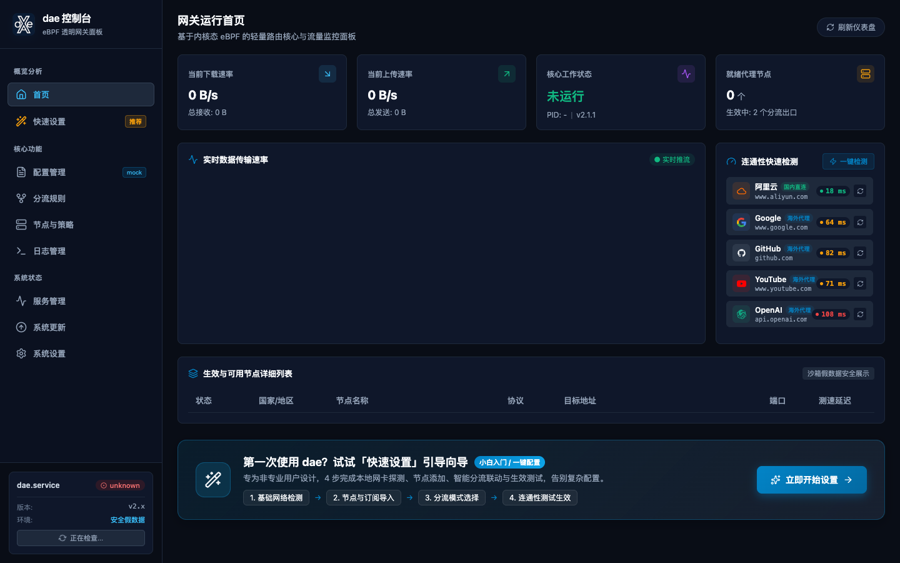
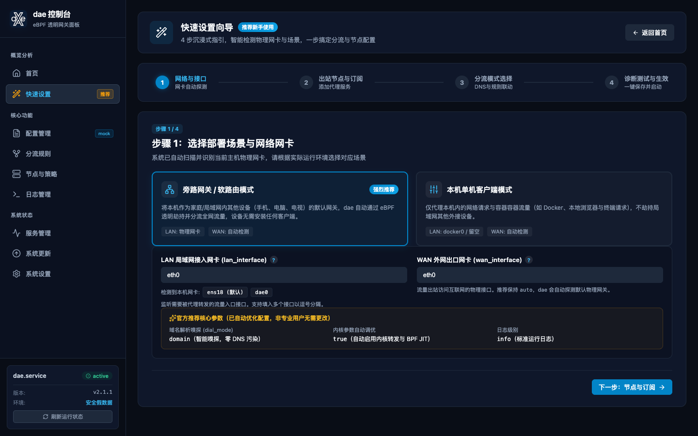
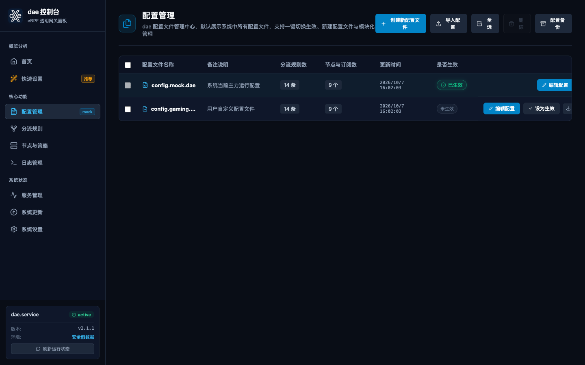
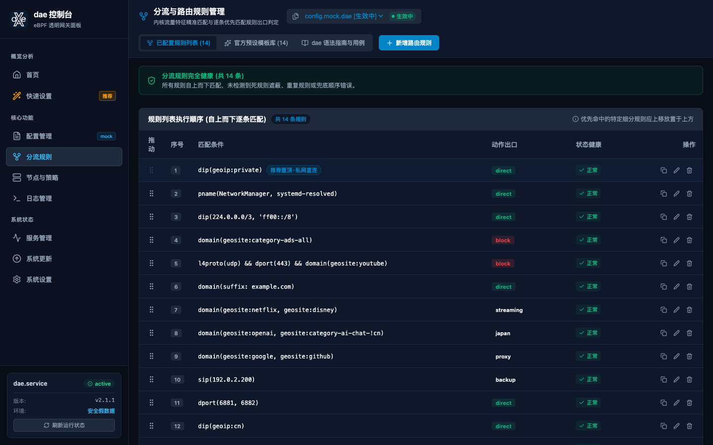
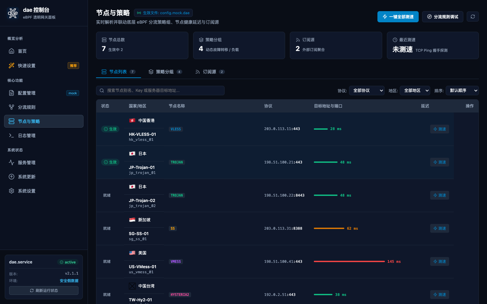
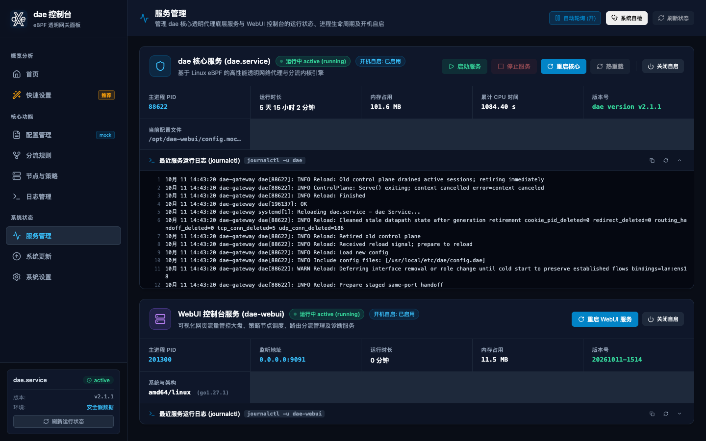

<p align="center">
  
</p>

<h1 align="center">daeX Console (dae-webui)</h1>

<p align="center">
  <b>Next-Generation Linux eBPF Transparent Proxy Console & Visual Gateway Panel</b>
  <br />
  <i>Lightweight · High Performance · Single Embedded Binary · Modern UI · 100% Bilingual (EN/ZH)</i>
</p>

<p align="center">
  <a href="README_EN.md"><b>English</b></a> | <a href="README.md"><b>简体中文</b></a>
</p>

<p align="center">
  
  
  
</p>

---

## 📸 UI Screenshots Gallery

### 1. Real-time Traffic Dashboard & Latency Probing
Real-time upload and download traffic charts, kernel state, outbound connectivity probes (Aliyun, Google, GitHub, YouTube, OpenAI), and available proxy nodes overview.
<p align="center">
  
</p>

---

### 2. 4-Step Quick Setup Wizard
Designed specifically for home gateway & bypass routing: auto-detection of physical NICs, bulk subscription and node import, preset routing modes, eye-catching 3-color latency badges, and one-click activation.
<p align="center">
  
</p>

---

### 3. Profile Management & Syntax Validation
Manage multiple `.dae` profiles, switch and activate with one click, perform real-time `dae validate` syntax checking, pinpoint error lines with red highlights, and import/export configurations.
<p align="center">
  
</p>

---

### 4. Visual Routing Rules Engine & Preset Templates
Strictly adheres to dae's "First-Match-Wins" rule hierarchy. Supports drag-and-drop reordering, shadow rule detection, LAN direct protections, and official preset template libraries.
<p align="center">
  
</p>

---

### 5. Outbound Nodes & Grouping Policies
Parse and manage VLESS, VMess, Trojan, Shadowsocks, Hysteria2 protocols. Schedule grouping policies (`min_moving_avg`, `min_avg10`, `fallback`, `random`) with automatic subscription updates.
<p align="center">
  
</p>

---

### 6. System Service Management & Health Diagnostics
Seamless integration with systemd daemon: live metrics (PID, Memory, CPU, Uptime), full lifecycle actions (Start, Stop, Restart, Reload), and automated system diagnostic health checks.
<p align="center">
  
</p>

---

## 🌟 Key Features

- 🚀 **Single Embedded Binary**: Go standard library backend with an embedded Vue 3 SPA. Zero external runtime dependencies (no Python, PHP, or Nginx required).
- 🪄 **Guided Quick Setup**: 4-step wizard tailored for bypass gateways and client modes. Recommends optimal kernel parameters, handles bulk link parsing, and archives configurations cleanly.
- 📊 **Real-time Traffic Monitor**: Millisecond-level traffic stream, interactive throughput curves, and one-click latency diagnostics for global services.
- 🔀 **Visual Routing Engine**: Full drag-and-drop rule ordering, condition builders (domain, geosite, geoip, dip, dport, pname), and built-in ruleset templates.
- 🌐 **Comprehensive Protocol Support**: Automatically extracts and normalizes outbound nodes from multi-protocol share links and provider subscriptions.
- 📜 **Live Logs & Snapshots**: Colored real-time journalctl streaming (INFO/WARN/ERROR/DEBUG), keyword filtering, and downloadable log backups.
- ⚙️ **Service Lifecycle Control**: Manage both `dae` and `dae-webui` services via systemd, inspect resource utilization, and trigger smooth configuration reloads.
- 🩺 **Built-in System Doctor**: Command-line and WebUI diagnostics validating kernel eBPF support, BPF mount points, config syntax, and network paths.
- 🌓 **Dual Themes & Full Bilingual**: Seamless dark/light theme toggle and 100% complete English and Simplified Chinese support.

---

## ⚡ Automated Installation

### 1. One-Line Online Install (Recommended)

Run the following command on your Linux server (root privileges required):

```bash
curl -fsSL https://raw.githubusercontent.com/Mikelee2022/dae-webui/main/install.sh | bash
```

### 2. Custom Parameters Install

Customize listen port or specify an existing dae configuration path:

```bash
curl -fsSL https://raw.githubusercontent.com/Mikelee2022/dae-webui/main/install.sh | bash -s -- --port 9091 --config /usr/local/etc/dae/config.dae
```

### 3. Install from Source Clone

```bash
git clone https://github.com/Mikelee2022/dae-webui.git /opt/dae-webui
cd /opt/dae-webui
sudo ./install.sh install
```

---

## 🛠️ CLI Options & Subcommands

The `install.sh` management script provides daily maintenance subcommands:

```bash
sudo ./install.sh [command] [options]
```

### Subcommands

| Command | Description |
|---|---|
| `install` | Install binaries and register systemd service (default) |
| `doctor` / `check` | Check system environment and eBPF readiness |
| `update` | Check and pull latest release |
| `restart` | Restart dae-webui service |
| `status` | View current service status and resource usage |
| `logs` | Follow real-time systemd service logs |
| `stop` | Stop dae-webui service |
| `start` | Start dae-webui service |
| `uninstall` | Safely uninstall service and binaries |

### Command Options

| Option | Default | Description |
|---|---|---|
| `--port <PORT>` | `9091` | WebUI listen port |
| `--host <HOST>` | `0.0.0.0` | WebUI bind address |
| `--config <PATH>` | *Auto-detected* | Path to dae configuration file |
| `--bin <PATH>` | `/usr/local/bin/dae` | Path to dae binary |
| `--service <NAME>` | `dae` | Name of underlying dae systemd service |
| `--no-start` | `false` | Do not immediately start service after installation |
| `-y, --yes` | `false` | Non-interactive silent installation |

---

## 🔑 Access & Initial Login

Once installed, navigate to the console in your browser:

- **URL**: `http://<YOUR_SERVER_IP>:9091`
- **Default Username**: `admin`
- **Default Password**: `admin123`

> ⚠️ **Security Notice**: Please change the default password immediately under **Settings** after first login.

---

## 🖥️ Systemd Service Management

`dae-webui` is registered as a standard systemd service: `dae-webui.service`.

```bash
# Check status
systemctl status dae-webui

# Restart service
systemctl restart dae-webui

# Stop service
systemctl stop dae-webui

# Follow logs
journalctl -u dae-webui -f

# Enable on boot
systemctl enable dae-webui
```

---

## ⚙️ Environment Variables & Flags

| Flag | ENV | Default | Description |
|---|---|---|---|
| `-listen` | `DAE_WEBUI_LISTEN` | `0.0.0.0:9091` | HTTP bind address and port |
| `-dae-config` | `DAE_CONFIG` | *(Required)* | Path to dae configuration |
| `-dae-bin` | `DAE_BIN` | `/usr/local/bin/dae` | Executable path of dae |
| `-dae-service` | `DAE_SERVICE` | `dae` | Systemd service unit name |
| `-backup-dir` | `DAE_BACKUP_DIR` | `<config_dir>/backups` | Configuration snapshots directory |
| `-allow-system-config` | `DAE_ALLOW_SYSTEM_CONFIG` | `false` | Allow loading `/etc/dae/` in production |

---

## 🩺 System Diagnostics (Doctor)

Verify kernel compatibility, BPF mounts, and configurations:

```bash
sudo ./install.sh doctor
```

Verification steps:
- ✅ **Linux Kernel & Architecture** (Kernel 5.8+, 5.15+ recommended)
- ✅ **eBPF Filesystem** (Mounted at `/sys/fs/bpf`)
- ✅ **Systemd Manager** (Active state and units)
- ✅ **dae Core Binary** (Permissions and version output)
- ✅ **Configuration Validation** (`dae validate -c`)
- ✅ **Asset Databases** (`geosite.dat` and `geoip.dat`)
- ✅ **Permissions** (Ensures `0600` access mode on secrets)

---

## 💻 Build from Source

### Prerequisites
- **Go** >= 1.22
- **Node.js** >= 18.x
- **pnpm** >= 8.x

### Build Steps
```bash
# 1. Build Frontend
cd frontend
pnpm install --frozen-lockfile
pnpm build

# 2. Build Backend Binary
cd ../backend
CGO_ENABLED=0 go build -trimpath -ldflags "-s -w -X main.version=$(date +%Y%m%d-%H%M)" -o ../bin/dae-webui .
```

---

## 📄 License

This project is licensed under the [MIT License](LICENSE).
